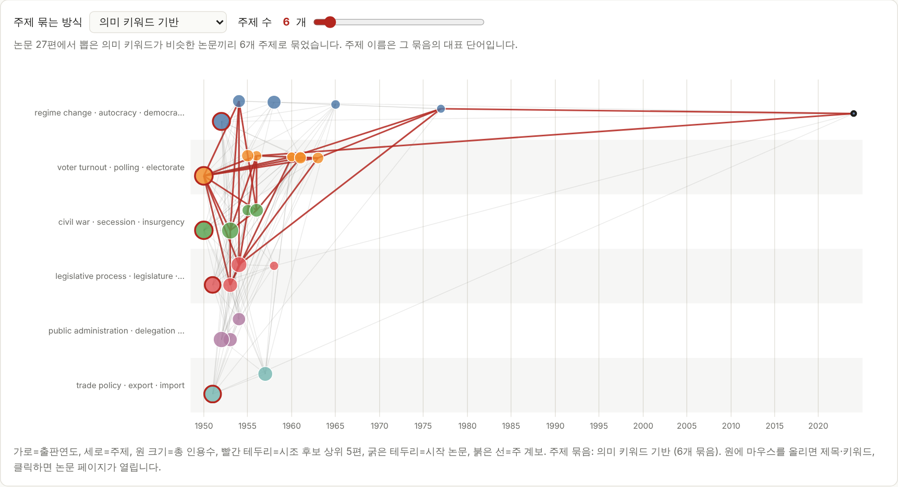

# 논문 시조 추적기 (paper-genealogy)

논문 제목이나 DOI를 넣으면 **참고문헌을 거슬러 올라가며** 인용 계보를 만들고, 그 계보의 **시조(원조) 후보 논문**을 찾아 주는 브라우저 도구입니다. 설치도 서버도 필요 없고, 파일 하나(`index.html`)로 동작합니다.

> **English summary** — A single-file, zero-install web tool that walks a paper's reference list backwards (via the OpenAlex API), builds its ancestor citation network, extracts meaningful keywords to group papers into themes, and ranks candidate "founding papers". Runs entirely in your browser. UI is in Korean.



<sub>▲ 가짜 인용망으로 만든 예시 화면입니다. 실제 논문 데이터가 아닙니다.</sub>

## 무엇을 하나요

- **시조 후보 순위**: 내 논문에서 참고문헌을 거슬러 올라가 여러 갈래가 수렴하는 오래된 논문을 점수로 뽑습니다.
- **연도 × 주제 지도**: 논문의 제목·키워드에서 의미 있는 단어를 뽑아 비슷한 논문끼리 주제로 묶고(주제 이름은 대표 단어), 연도 축에 펼쳐 계보를 한눈에 보여 줍니다. 원 크기는 인용수입니다.
- **핵심 키워드의 기원**: 내 논문의 핵심 단어를 조상 논문 중 누가 가장 먼저 썼는지 보여 줍니다.
- 시작 논문 → 시조 후보 1위까지의 **주 계보**, **연대별 시계열**, **주제별 정리**, 그리고 **PDF / CSV / JSON 저장**.

## 사용법

**방법 1. 웹에서 바로 쓰기** — 이 저장소를 GitHub Pages로 배포하면 `https://<사용자명>.github.io/<저장소명>/` 주소에서 쓸 수 있습니다. ([배포 방법](#github-pages로-배포하기))

**방법 2. 내 컴퓨터에서** — `index.html`을 내려받아 브라우저(Chrome, Edge, Safari 등)로 열면 됩니다. 인터넷 연결만 필요합니다.

1. 입력창에 논문 **영문 제목**, **DOI**, 또는 **OpenAlex ID**(`W…`)를 넣고 "시조 추적"을 누릅니다.
2. 추적 범위는 슬라이더로 고릅니다. 처음 값은 **6단계 / 논문당 참고문헌 50편 / 수집 상한 500편**입니다. 값이 클수록 계보가 촘촘하지만 오래 걸리고 요청이 많아집니다.
3. 진행 표시(경과 시간, 서버 요청 횟수, 수집한 논문 수)가 올라가는 동안 기다리면 리포트가 나옵니다.
4. 지도 위의 **"주제 묶는 방식"**(의미 키워드 / OpenAlex 분류명)과 **주제 수** 슬라이더는 추적을 다시 하지 않고 즉시 반영됩니다.
5. "PDF로 저장"을 누르고 인쇄 창에서 대상을 **PDF로 저장**으로 고르면 보고서만 A4로 저장됩니다.

## 어떻게 작동하나요

요약하면 다음과 같습니다. 자세한 내용은 [docs/HOW_IT_WORKS.md](docs/HOW_IT_WORKS.md)에 있습니다.

1. **계보 구축** — OpenAlex에서 참고문헌 목록을 읽어 단계별로 거슬러 올라갑니다. 논문당 많이 인용된 상위 N편만 더 위로 확장해 인용망이 폭발하지 않게 합니다.
2. **시조 점수** — 경로 수 30%, 조상 내 피인용 25%, 전체 인용수 15%, 오래됨 20%, 의미 키워드 유사도 10%를 순위 백분위로 합산합니다.
3. **의미 키워드 주제** — 제목·키워드에서 뽑은 단어를 TF-IDF로 가중하고, 단어 패턴이 비슷한 논문끼리 묶습니다.

## 데이터와 개인정보

- 모든 계산은 **내 브라우저 안에서** 이루어집니다. 이 도구 자체의 서버는 없고, 분석 결과를 어디에도 보내거나 저장하지 않습니다.
- 브라우저가 [OpenAlex](https://openalex.org) API(논문 정보)와 필요할 때 [Semantic Scholar](https://www.semanticscholar.org) API(참고문헌 보완)를 **직접** 호출합니다. 따라서 입력한 논문의 제목·DOI와 조회하는 논문 ID가 이 두 서비스에는 전달됩니다.
- **Google Scholar는 쓰지 않습니다.** 참고문헌 목록(조상 방향)을 제공하지 않고, 자동 수집이 이용약관상 금지·차단되어 있기 때문입니다.
- OpenAlex 데이터는 CC0, Semantic Scholar API는 해당 서비스의 이용약관을 따릅니다.

## 한계

- **점수는 후보를 좁혀 주는 휴리스틱**입니다. 상위 후보는 직접 읽고 판단하세요. 단어를 처음 *쓴* 논문이 그 개념의 원조라는 보장도 없습니다.
- "의미 키워드"는 단어가 함께 쓰이는 패턴을 보는 방식이라, 뜻을 이해하는 수준은 아닙니다. 동의어가 서로 다른 논문에서만 쓰이면 다른 주제로 갈라질 수 있습니다.
- 영어 제목·키워드에 가장 잘 맞습니다. 한글 제목은 띄어쓰기 단위로만 나눕니다.
- 가지치기(논문당 상위 N편만 확장) 때문에 인용이 적은 계보는 빠질 수 있습니다. 의심되면 확장 수를 키우세요.
- OpenAlex와 Semantic Scholar 모두 참고문헌이 비어 있는 논문은 거기서 계보가 끊깁니다.
- OpenAlex는 짧은 시간에 요청이 몰리면 속도 제한을 걸 수 있습니다. 앱이 자동으로 재시도하며 로그에 표시합니다.
- 자동 테스트는 가짜 API로 실행됩니다. 실제 서비스 응답 구조는 OpenAlex 공식 문서를 기준으로 구현했으니, 실제 사용 중 문제를 발견하면 이슈로 알려 주세요.

## 개발

```bash
pip install -r requirements-dev.txt
python -m playwright install chromium     # 브라우저 테스트용 (처음 한 번)
python -m pytest                          # 테스트 17개, 약 15초, 인터넷 불필요
python scripts/make_screenshot.py         # README 스크린샷 다시 만들기
```

- `index.html` — 앱 전체(HTML + CSS + JS, 외부 라이브러리 없음)
- `tests/` — Playwright로 브라우저를 띄우고 OpenAlex 응답을 가짜로 대체해 검증합니다.
- `cli/` — 초기 버전 명령줄 도구입니다. **웹 앱과 알고리즘이 다릅니다**(분류명 기준 주제, 지도 8칸 등). 대량 수집이나 스크립트 실행용으로만 남겨 두었습니다. 사용법은 [cli/README.md](cli/README.md).

### GitHub Pages로 배포하기

1. GitHub에 저장소를 만들어 이 코드를 `main` 브랜치로 올립니다.
2. 저장소 **Settings → Pages → Build and deployment → Source**를 **GitHub Actions**로 바꿉니다.
3. `main`에 푸시할 때마다 `.github/workflows/pages.yml`이 `index.html`을 배포합니다. 완료되면 Actions 실행 결과에 주소가 표시됩니다.

`.github/workflows/ci.yml`은 푸시와 풀 리퀘스트마다 테스트를 실행합니다.

## 라이선스

[MIT](LICENSE)
